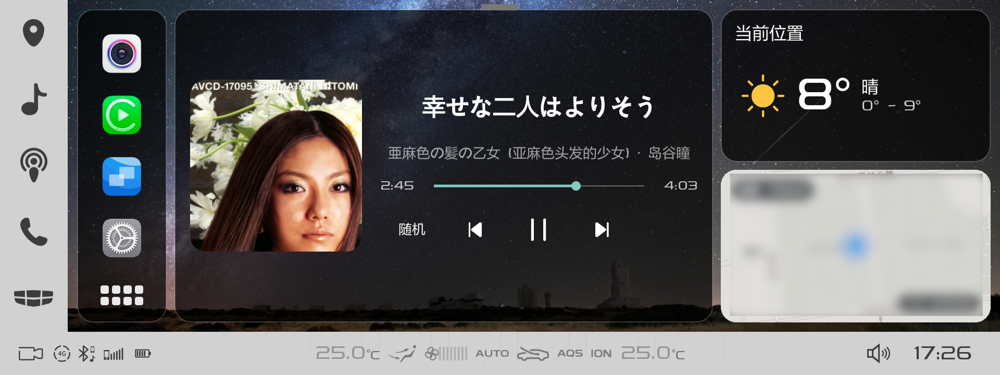
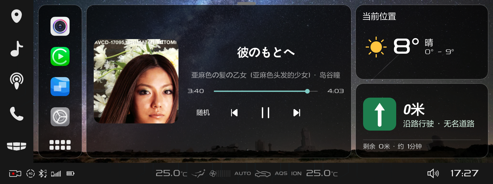
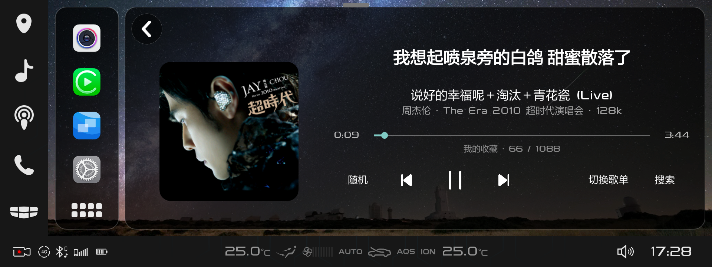
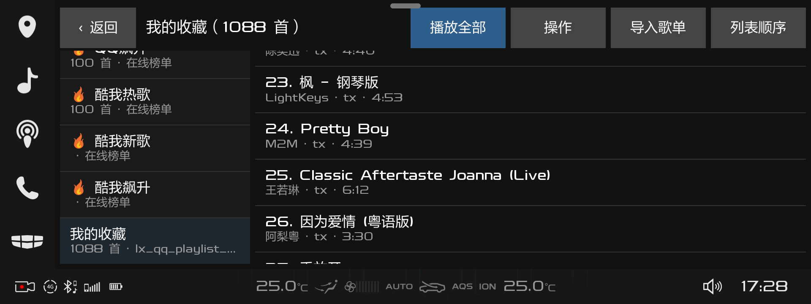
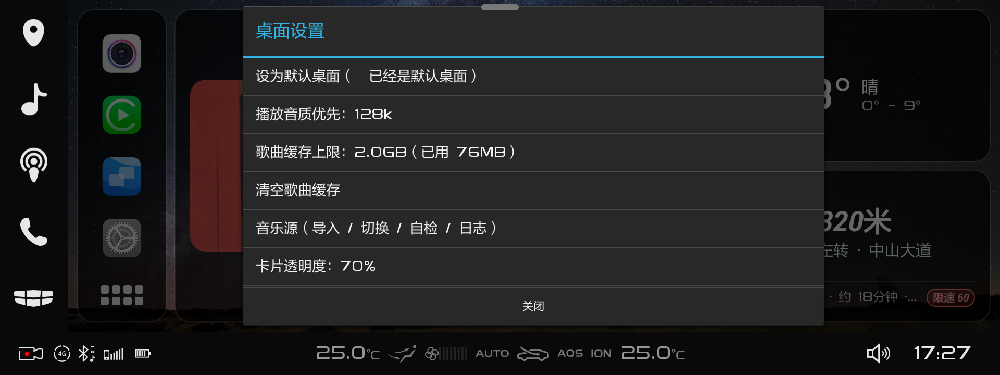

# HAPlayer-LX — 轻量级车机音乐桌面（支持 Android 4.4+）

一款面向**老旧车机（Android 4.4.2 / API 19，32 位 ARM，1.7GB RAM，横屏宽屏）**深度优化的 CarPlay 风格车载桌面与音乐播放器，同时兼容较新版本的 Android 车机与平板设备。

> **免责声明**：本开源项目**不包含、不内置、不提供**任何第三方音乐源脚本、API Key 或受版权保护的音频内容。应用仅提供本地播放能力与通用的自定义 JS 音源加载框架，用户如需在线播放请自行导入合法合规的自定义脚本。

---

## 界面预览（车机实机截图）

**主桌面（左侧 Dock + 音乐歌词卡片 + 天气 + 2D 巡航小地图）**


**主桌面（高德车机版导航中自动切换为 TBT 实时诱导卡片）**


**音乐播放页（大字歌词 + 封面 + 进度与播控）**


**歌单与榜单页（支持在线榜单与歌单导入）**


**桌面设置（默认桌面、音质优先、缓存管理、音源管理、卡片透明度）**


---

## 核心特性

### 1. CarPlay 风格车机桌面
- **横屏宽屏布局**：针对 `1920×720` 等车机宽屏比例优化，大字体、大触控热区，方便行车盲操。
- **可设默认桌面（HOME）**：支持作为系统默认桌面运行，并可在「桌面设置」中随时切回原厂系统桌面。
- **壁纸轮播**：支持自定义本地或 U 盘壁纸目录，定时自动切换。
- **实时天气卡片**：接入 Open-Meteo / wttr.in（免 Key），支持 GPS 自动定位或手动指定城市，带本地缓存。
- **常用应用与全部应用**：支持自定义 Dock / 常用应用快捷槽位。

### 2. 音乐播放与自定义音源框架
- **本地 & U 盘播放**：支持扫描车机存储与常见 U 盘挂载点，内嵌封面读取、本地 `.lrc` 歌词同步。
- **在线播放与缓存**：基于 `ExoPlayer 2.18`（`minSdk 16`）实现流式播放与本地边播边存缓存管理（`MusicCache`），支持方控媒体键（上一曲 / 下一曲 / 播放暂停）。
- **自定义音源脚本引擎（QuickJS）**：
  - 支持导入兼容 LX Music 协议的自定义 `.js` 脚本（支持远程 URL 或 U 盘 / `/sdcard/CarMusic/sources/` 本地文件导入）。
  - 源码级集成 `quickjs-wrapper 2.4.0`，使用 **NDK r25c** 按 `minSdk 19` 静态编译，彻底解决 Android 4.4 缺失 `fesetround` 与高版本 C++ 运行库符号的问题。
- **Android 4.4 现代 HTTPS 兼容**：集成 `Conscrypt` + 内置现代根证书（ISRG Root X1、DigiCert、GTS 等），让 Android 4.4 也能正常访问 TLS 1.2/1.3 接口。

### 3. 轻量导航卡片（2D 巡航小地图 + 高德 TBT 诱导）
- **2D 栅格瓦片巡航小地图（`MiniMapView`）**：
  - 零第三方重型地图 SDK，纯 2D `Canvas` 绘制，内置 **WGS-84 → GCJ-02** 国内坐标纠偏。
  - 针对小内存车机优化：内存严格限制 24 张 `RGB_565` 瓦片（约 3 MB），配合本地磁盘缓存；退后台或切入导航时自动停止 GPS 监听并释放内存缓存。
- **高德车机版导航广播联动（`AmapNavMonitor`）**：
  - 监听高德地图车机版（`com.autonavi.amapauto`）标准广播 `AUTONAVI_STANDARD_BROADCAST_SEND`（`KEY_TYPE = 10001 / 10019`）。
  - 导航开始后自动切换为 CarPlay 风格 TBT 诱导卡片（纯 Canvas 转向箭头 + 下个路口距离 + 路名 + 剩余里程/时间 + 限速提示），内置 25 秒超时自动恢复保护。

---

## 目录结构

```text
haplayer-lx/
├── app/
│   ├── build.gradle                  # 构建配置（AGP 8.3.0 / NDK 25.2.9519653 / CMake 3.22.1）
│   └── src/main/
│       ├── AndroidManifest.xml
│       ├── assets/
│       │   ├── certs/                # Android 4.4 补充根证书（PEM）
│       │   └── lx/lx-preload.js      # QuickJS 运行时桥接层
│       ├── cpp/fenv_compat.h         # Android 4.4 缺失的 fesetround/fegetround 兼容实现
│       ├── java/com/mcool/player/
│       │   ├── home/                 # 桌面、Dock、天气、壁纸、2D 小地图、高德 TBT 监听
│       │   ├── music/                # 音乐页、歌单、榜单、歌词、本地扫描、音频缓存
│       │   ├── lx/                   # QuickJS 引擎封装、音源管理、日志脱敏
│       │   ├── online/               # 在线搜索/歌单/歌词适配
│       │   └── net/                  # Conscrypt TLS + HttpURLConnection 封装
│       └── res/                      # 布局、图标与样式资源
├── tools/
│   ├── setup_quickjs.sh              # 自动拉取 quickjs-wrapper 2.4.0 及 native/quickjs 子模块
│   └── check_so_symbols.sh           # 装机前检查 .so 在 Android 4.4 真机上是否缺符号
└── build.gradle
```

---

## 编译与构建指南

### 环境依赖
- **JDK**：17 或 21（推荐 OpenJDK 21）
- **Android SDK**：`platforms;android-34`、`build-tools;34.0.0`、`platform-tools`
- **Android NDK**：**`25.2.9519653`**（NDK r25c，最后一个支持 `minSdk 19` 的版本，r26 起最低为 21）
- **CMake**：**`3.22.1`**
- **Gradle**：`8.5` ~ `8.11`

### 步骤 1：拉取 QuickJS 源码
工程不直接打包上游 `quickjs-wrapper` 源码，构建前需先运行脚本拉取：

```bash
cd haplayer-lx
bash tools/setup_quickjs.sh
```

脚本会自动克隆 `HarlonWang/quickjs-wrapper` 并切换到 `2.4.0`（含 `native/quickjs` 子模块）到 `third_party/quickjs-wrapper/`。

### 步骤 2：配置 Android SDK 路径
在 `haplayer-lx/` 根目录创建 `local.properties`（已被 `.gitignore` 忽略）：

```properties
sdk.dir=/你的/Android/sdk/路径
```

### 步骤 3：编译 Debug APK
使用 Android Studio Sync & Build，或通过命令行编译：

```bash
gradle assembleDebug
```

产物位于：`app/build/outputs/apk/debug/app-debug.apk`。

### 步骤 4：Android 4.4 符号完整性检查（强烈建议）
编译成功不代表老车机一定能加载 `.so`。连上车机 USB 后执行：

```bash
bash tools/check_so_symbols.sh
```

脚本会从 APK 解出 `libquickjs-android-wrapper.so`，对比车机 `/system/lib/` 导出符号（并缓存至 `tools/device_libs/`），显示 `✅ 通过`（缺失数为 0）后再装机。

### 步骤 5：ADB 安装到车机

- **较新 Android 设备（支持流式安装）**：
  ```bash
  adb install -r app/build/outputs/apk/debug/app-debug.apk
  ```
- **Android 4.4 老车机（推荐 `push + pm install`，避免新版 adb 流式安装断连）**：
  ```bash
  adb push app/build/outputs/apk/debug/app-debug.apk /data/local/tmp/haplayer.apk
  adb shell "pm install -r /data/local/tmp/haplayer.apk && rm -f /data/local/tmp/haplayer.apk"
  ```

---

## 自定义音源导入方式

开源版不内置任何音源脚本，安装后可通过以下方式导入你自己的 `.js` 音源脚本：
1. **远程 URL 导入**：在应用内进入「音乐源」→「远程 JS」，填入脚本链接即可下载并启用。
2. **本地 / U 盘导入**：将 `.js` 脚本放入 U 盘根目录，或通过 ADB 推送到 `/sdcard/CarMusic/sources/`，再点击「U盘/文件」导入。
3. **本地自编译内置（仅限个人使用）**：如需给自己打私有包，可将脚本放到 `app/src/main/assets/lx/sources/builtin.js`（该目录已在 `.gitignore` 中排除，不会被提交到 Git）。

---

## Android 4.4 关键兼容说明

- **`fenv_compat.h`**：Android 4.4 的 `libm.so` 缺少 `fesetround` / `fegetround`，`app/build.gradle` 通过 `-include src/main/cpp/fenv_compat.h` 同时注入到 C 与 C++ 编译参数，利用 ARM VFP `FPSCR` 寄存器实现兼容。
- **静态 STL**：CMake 参数配置 `-DANDROID_STL=c++_static`，避免依赖高版本 `libc++_shared.so`。
- **旧式原生库打包**：`packagingOptions.jniLibs.useLegacyPackaging = true`，兼容 Android 4.4 安装器。
- **日志脱敏**：`LxLog` 自动对 URL 中的 `key / apikey / vkey / token / sign` 等敏感参数打码后再写入 `/sdcard/CarMusic/logs/`。

---

## 致谢与许可

- QuickJS Java/Android 封装参考自 [HarlonWang/quickjs-wrapper](https://github.com/HarlonWang/quickjs-wrapper)
- 音频流播放基于 [ExoPlayer](https://github.com/google/ExoPlayer)
- Android 4.4 TLS 1.2/1.3 支持基于 [Conscrypt](https://github.com/google/conscrypt)
- 天气数据接口基于 [Open-Meteo](https://open-meteo.com/)

本项目仅用于个人车载设备折腾与技术学习交流，请遵守相关法律法规与第三方服务条款。
